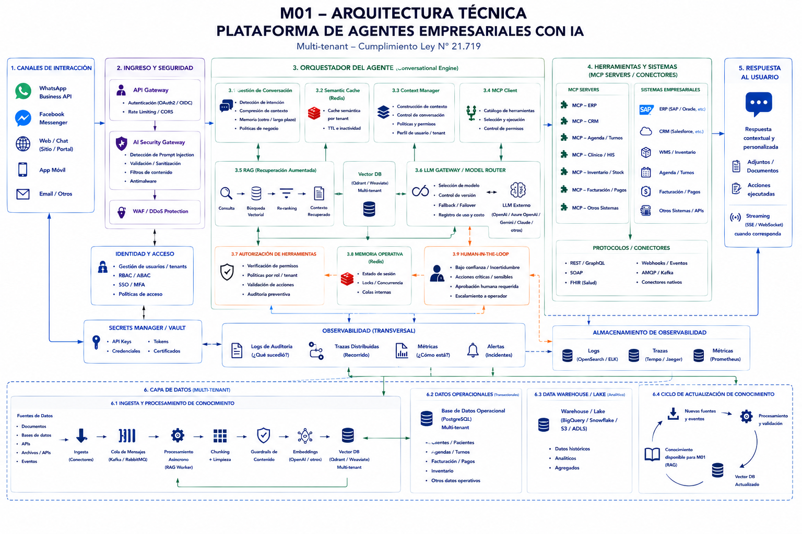
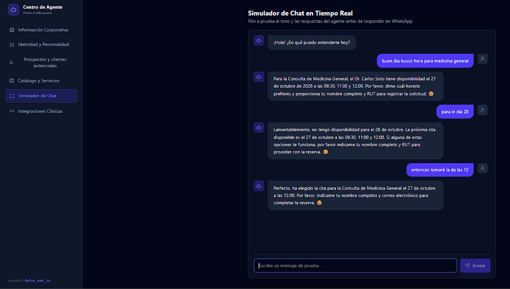
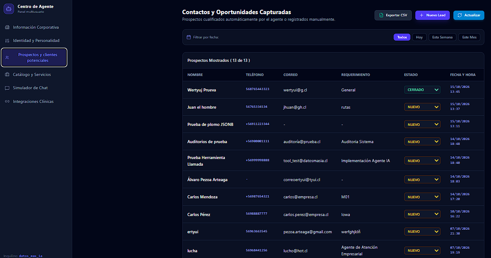
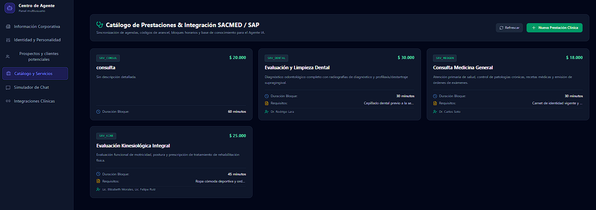
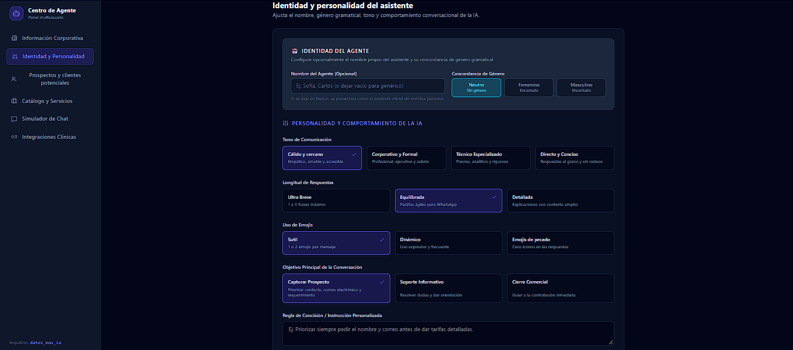
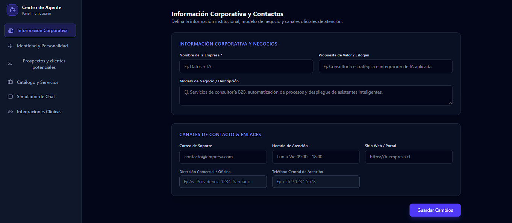
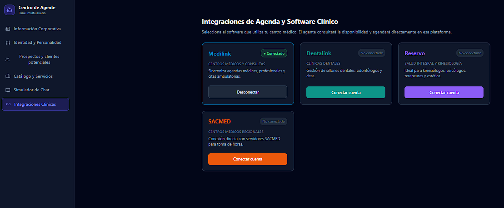

# M01 — Enterprise AI Agent Suite: Arquitectura de Agendamiento Clínico y Orquestación Transaccional

Plataforma de agentes conversacionales empresariales (PaaS) diseñada para resolver la fricción operativa en la gestión de turnos médicos, consulta de disponibilidad en tiempo real y captura estructurada de prospectos mediante modelos de lenguaje (LLMs) supervisados (**Human-in-the-Loop**)[cite: 1, 2].

> **Aviso de Propiedad Intelectual:** Este repositorio constituye un *Technical Showcase / Caso de Estudio de Arquitectura*. El código de producción, los conectores propietarios y los modelos de negocio se mantienen en repositorio privado bajo resguardo de propiedad intelectual y acuerdos de confidencialidad clínica.

---

## 🎯 1. Problema de Negocio y Enfoque

En organizaciones de salud y servicios críticos, la automatización 100% autónoma mediante LLMs representa un riesgo operativo alto debido a alucinaciones de disponibilidad, compromisos erróneos de agenda médica y falta de verificación de normativas de datos sensibles[cite: 2].

**M01-Agent** mitiga este riesgo desacoplando la comprensión conversacional de la ejecución de negocio:
- **Separación entre Generación y Ejecución:** El modelo interpreta y extrae intenciones, pero la ejecución de acciones transaccionales se delega a herramientas autorizadas bajo el estándar **MCP (Model Context Protocol)** y validaciones algorítmicas locales[cite: 1, 2].
- **Arquitectura Human-in-the-Loop (HITL):** Aplicación de un bloqueo transaccional temporal de 20 minutos (*soft-lock*) y registro del prospecto en estado calificado, derivando la confirmación final al personal administrativo médico[cite: 1].
- **Validación Determinista de Identidad:** Cálculo local del algoritmo Módulo 11 para validación de RUT chileno y control estricto de zona horaria (`America/Santiago`), reduciendo latencia (<1 ms) y consumo innecesario de tokens.

---

## 🏗️ 2. Arquitectura Técnica del Sistema

El diseño se estructura bajo un enfoque desacoplado, modular y multi-tenant, garantizando aislamiento estricto de datos y seguridad en cada capa operativa[cite: 1, 2]:

### Capas Principales de la Solución:
1. **Canales de Interacción:** Puntos de contacto omnicanal (WhatsApp Business API vía BSP, Web Console en React 18, Webhooks)[cite: 1].
2. **Ingreso y Seguridad:** API Gateway con autenticación centralizada, rate limiting determinista y AI Security Gateway especializado en detección de prompt injections, sanitización RegEx y WAF/DDoS[cite: 1].
3. **Orquestador Conversacional:** Motor de orquestación asíncrono con control de sesión, Context Manager, caché semántica en Redis, RAG multi-tenant y router de modelos con soporte failover[cite: 1].
4. **Capa de Herramientas (MCP Servers / Conectores):** Conectores estandarizados hacia sistemas core empresariales (SACMED/SAP, Medilink, Dentalink, Reservo, CRM) a través de protocolos REST, GraphQL, SOAP y estándares clínicos (FHIR)[cite: 1].
5. **Persistencia y Observabilidad:** Almacenamiento transaccional en PostgreSQL 16 con pool centralizado de conexiones anti-leaks, métricas continuas, trazas distribuidas y Audit Logs inmutables[cite: 1, 2].

---

## 🔌 3. Separación de Generación y Ejecución (Protocolo MCP)

Para evitar que el agente ejecute acciones destructivas o no verificables, la plataforma implementa una frontera de autorización estricta[cite: 1, 2]:

- **Principio de Mínimo Privilegio:** El LLM no posee credenciales directas a bases de datos transaccionales ni a los ERPs médicos[cite: 1, 2].
- **Frontera de Ejecución (Tool Authorization):** Cada invocación de herramienta requiere validación de esquema, verificación de políticas de rol (RBAC/ABAC) y confirmación de pre-condiciones[cite: 1].
- **Idempotencia y Trazabilidad:** Toda operación transaccional ejecutada por un conector MCP genera un identificador único de trazabilidad para permitir auditorías preventivas y rollbacks ante inconsistencias[cite: 1, 2].

---

## 🛡️ 4. Protocolos Fail-Safe y Contingencia Operativa

El principio central de contingencia establece que una falla de infraestructura o de inferencia jamás debe transformarse en una acción empresarial incorrecta o inventada[cite: 2]:

* **Mecanismo de Desconexión (*Kill Switch*):** Capacidad de congelar o pausar inmediatamente las acciones automatizadas de un agente ante anomalías en producción o incidentes de seguridad[cite: 1, 2].
* **Degradación Graciosa (*Graceful Degradation*):** Si una API externa (ej. agenda médica o sistema de inventario) no responde, el sistema conserva su función puramente informativa, pero bloquea cualquier confirmación transaccional[cite: 2].
* **Escalamiento Asistido:** Si el modelo detecta incertidumbre, conflicto de datos o caída de dependencias críticas, la sesión se transfiere a un operador humano conservando el historial y contexto estructurado completo[cite: 1, 2].

---

## 🔒 5. Privacidad, Gobernanza y Cumplimiento Normativo (Ley N° 21.719)

La solución fue concebida bajo principios de *Privacy by Design* y resguardo de datos personales sensibles (PII) en conformidad con la legislación chilena (Ley N° 21.719)[cite: 1, 2]:

* **Minimización de Datos:** Los datos sensibles del paciente se anonimizan y desidentifican antes de ser procesados por modelos de lenguaje externos[cite: 2].
* **Registro de Auditoría Inmutable (*Audit Logs*):** Trazabilidad completa de cada iteración, registrando `tenant_id`, versión del modelo, prompt dinámico utilizado, herramientas invocadas, tiempo de respuesta y resultado de ejecución[cite: 1, 2].
* **Aislamiento Multi-Tenant:** Separación lógica estricta a nivel de base de datos transaccional y colecciones vectoriales para garantizar la independencia de cada centro de salud[cite: 1, 2].

---

## 🖥️ 6. Demostración Visual de la Plataforma en Ejecución

### 1. Flujo Conversacional & Agendamiento Asistido
Interacción donde el asistente atiende, sanitiza la entrada, valida el RUT chileno mediante algoritmo local y genera la pre-reserva:

---

### 2. Bandeja de Entrada y Auditoría de Leads (Consola Administrativa)
Visualización centralizada de prospectos capturados con filtros de fecha, trazabilidad de datos y confirmación médica manual (HITL):

---

### 3. Catálogo de Prestaciones Clínicas (4 Bloques)
Estandarización de servicios de salud con duración médica estimada (`duration_minutes`), aranceles y asignación obligatoria de especialistas habilitados:

---

### 4. Gobernanza del Modelo: Personalidad e Identidad de Marca
Configuración desacoplada del comportamiento del agente, definición del tono, concordancia de género gramatical y límites operacionales:

---

### 5. Configuración de Identidad Corporativa
Gestión centralizada de sedes, horarios de atención, canales y directrices de atención médica inyectadas en tiempo real al System Prompt:

---

### 6. Capa de Integración & Conectores Clínicos (SAP / SACMED)
Módulo de parametrización de credenciales, endpoints y mapeo transaccional hacia software médico y ERPs clínicos:

---

## 📊 7. Marco de Calidad, Evaluación y Métricas (KPIs)

Para garantizar la estabilidad y confiabilidad del sistema antes y durante el despliegue en producción, se aplican criterios estructurados de aceptación[cite: 2]:

| KPI / Métrica | Dimensión Evaluada | Criterio de Control / Aceptación |
|---|---|---|
| **Relevance Score**[cite: 2] | Pertinencia de la respuesta frente a la solicitud y contexto recuperado[cite: 2]. | Umbral mínimo de pertinencia validado en fase piloto antes de pase a producción[cite: 2]. |
| **Hallucination Rate**[cite: 2] | Porcentaje de respuestas con afirmaciones no respaldadas en fuentes autorizadas[cite: 2]. | Auditoría periódica sobre muestras; umbral máximo estricto tolerado[cite: 2]. |
| **Tool Success Rate**[cite: 2] | Eficacia de invocación de herramientas (éxito vs. fallos o reintentos)[cite: 2]. | Monitoreo continuo de integraciones MCP y APIs externas[cite: 2]. |
| **Human Escalation Rate**[cite: 2] | Tasa de sesiones derivadas a operador humano categorizadas por motivo[cite: 2]. | Detección de brechas funcionales y reajuste de directrices operativas[cite: 2]. |
| **Data vs. Performance Drift**[cite: 2] | Separación analítica entre variación en la distribución de datos y pérdida de rendimiento[cite: 2]. | Detección temprana desacoplada: el drift de datos no implica necesariamente fallo del modelo[cite: 2]. |

---

## 🛠️ 8. Stack Tecnológico

- **Backend:** Python 3.14 · FastAPI (Arquitectura asíncrona)
- **Orquestación de IA:** OpenAI API (AsyncOpenAI) con Function Calling determinista
- **Persistencia:** PostgreSQL 16 (Docker) con `ThreadedConnectionPool` y context managers anti-leaks
- **Memoria Operativa & Caché:** Redis (Control de sesión y bloqueo transaccional)[cite: 1]
- **Frontend / Consola Web:** React 18 · Vite · Tailwind CSS
- **Seguridad & Calidad:** Protocolo MCP[cite: 1, 2], autenticación vía API Keys / HMAC y Quality Gates automatizados en PowerShell

---

## 👨‍💻 Autor
**Álvaro Alexis Pezoa Arteaga**  
*Enfoque en Arquitectura de Soluciones de IA, Automatización de Procesos y Auditoría de Datos.*